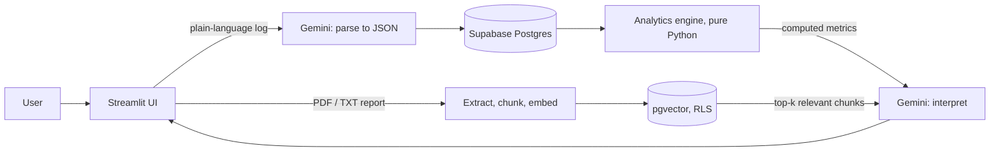

# GymCoachAI 🔥

**A gym tracker and training/nutrition planner with an AI coach that reads your numbers *and* your medical report.**

Log workouts and meals in plain language (English, Arabic, or Egyptian Arabic), watch your progress on a dashboard, and get weekly coaching that adapts to your data and health background.

[](https://www.python.org/)
[](https://streamlit.io/)
[](https://supabase.com/)
[](https://ai.google.dev/)

> **Design principle:** numbers are computed in code, never by the LLM. Gemini only *structures* free text and *interprets* metrics that were already calculated. This keeps the coach grounded and reduces hallucinated figures.

---

## Table of contents

- [Features](#features)
- [How it works](#how-it-works)
- [Tech stack](#tech-stack)
- [Project structure](#project-structure)
- [Getting started](#getting-started)
- [Configuration](#configuration)
- [Database](#database)
- [Testing](#testing)
- [Deployment](#deployment)
- [Privacy and security](#privacy-and-security)
- [Roadmap](#roadmap)
- [Disclaimer](#disclaimer)

---

## Features

| Area | What you get |
|---|---|
| **Workout log** | Describe a session the way you'd tell a friend (e.g. "3 sets of 15 lat pulldown at 40kg"). It is converted into structured sets with exercise, muscle group, reps, weight, and RPE. Unclear or missing values are flagged instead of invented. |
| **Nutrition tracker** | Log meals in plain language and track calories, protein, carbs, and fat against daily targets estimated from your profile. |
| **Dashboard** | Weekly training volume, estimated 1RM personal records, daily nutrition charts, body-weight trend, workout and logging streaks, and achievements. |
| **Medical report RAG** | Upload a `.pdf` or `.txt` report. It is chunked, embedded, and stored per user, so the coach can retrieve the relevant parts when you ask about injuries, conditions, or limits. |
| **AI Coach** | A weekly report built from your computed metrics, a training/nutrition plan builder, and a chat assistant with conversation history and per-session rate limiting. |
| **Bilingual** | Understands English, Arabic, and Egyptian Arabic gym slang. The coach can answer in the language you use. |
| **Auth and sessions** | Email/password sign-up and login with Supabase Auth, and a cookie-based session that survives browser refreshes. |

---

## How it works



1. **Structure.** Free-text workouts and meals are turned into validated JSON by Gemini.
2. **Compute.** `utils/analytics.py` and `utils/progress.py` calculate volume, PRs (Epley 1RM), streaks, and nutrition targets. These are pure functions with no Streamlit or LLM calls.
3. **Retrieve.** When a question touches health, the most similar report chunks are fetched with a pgvector similarity search that runs under the user's own permissions.
4. **Interpret.** Gemini explains the precomputed numbers and the retrieved excerpts. It never calculates the metrics itself.

### Medical report pipeline

`extract (pypdf / txt)` → `clean` → `chunk (~900 chars, 150 overlap, Arabic-aware sentence splitting)` → `embed (gemini-embedding-001, 768 dims)` → `store (pgvector + HNSW index)` → `search (cosine similarity via match_report_chunks)`

Scanned, image-only PDFs are not supported (no OCR yet). Paste the report text instead.

---

## Tech stack

| Layer | Technology |
|---|---|
| UI | [Streamlit](https://streamlit.io/) with a custom red/black theme and [Plotly](https://plotly.com/python/) charts |
| Auth and database | [Supabase](https://supabase.com/) (Auth + PostgreSQL) |
| Vector search | [pgvector](https://github.com/pgvector/pgvector) with an HNSW index |
| LLM and embeddings | [Google Gemini](https://ai.google.dev/) via `google-genai` |
| Data handling | pandas, pypdf |
| Config | python-dotenv locally, Streamlit secrets in production |
| Tests | pytest (no network or API keys needed) |
| Hosting | Streamlit Community Cloud + Supabase free tier |

---

## Project structure

```
AI-Coach/
├── app.py                    # Entry point: auth screen, navigation, page routing
├── ui/                       # One module per page
│   ├── dashboard_page.py
│   ├── workout_page.py
│   ├── nutrition_page.py
│   ├── medical_page.py
│   └── coach_page.py
├── utils/
│   ├── db.py                 # Supabase client, auth, cookie session handling
│   ├── llm.py                # Gemini: parsing, embeddings, reports, chat
│   ├── rag.py                # Extract, chunk, embed, store, search
│   ├── analytics.py          # Weekly metrics, PRs, flags, series
│   ├── progress.py           # Targets, streaks, exercise history, achievements
│   ├── chat.py               # Chat context, history trimming, rate limiting
│   ├── workouts.py / meals.py
│   ├── theme.py              # Red/black theme and UI components
│   └── cookie_component/     # Tiny custom component for persistent login
├── db/
│   ├── schema.sql            # Full schema (fresh project)
│   └── migrations/           # Incremental SQL for older databases
├── tests/                    # pytest suite with a fake DB
├── .streamlit/config.toml    # Theme settings
├── .devcontainer/            # Codespaces / VS Code dev container
├── DEPLOY.md                 # Step-by-step deployment guide
└── requirements.txt
```

---

## Getting started

### Prerequisites

- Python 3.11 or newer
- A free [Supabase](https://supabase.com/) project
- A [Gemini API key](https://aistudio.google.com/apikey)

### Installation

```bash
# 1. Clone the repository
git clone https://github.com/Ahmedmo362023/AI-Coach.git
cd AI-Coach

# 2. Create and activate a virtual environment
python -m venv .venv
source .venv/bin/activate        # Windows: .venv\Scripts\activate

# 3. Install dependencies
pip install -r requirements.txt
```

### Set up the database

1. In the Supabase dashboard, open **SQL Editor**.
2. Run [`db/schema.sql`](db/schema.sql) on a fresh project.
3. Run [`db/migrations/004_profile_sex.sql`](db/migrations/004_profile_sex.sql) once. It adds the optional `sex` field used to refine the calorie estimate.

### Configure the environment

Create a `.env` file in the project root (see [Configuration](#configuration)), then start the app:

```bash
streamlit run app.py
```

Open <http://localhost:8501>, sign up, and fill in your profile.

---

## Configuration

Create `.env` locally, or paste the same keys into **Secrets** on Streamlit Community Cloud.

```env
SUPABASE_URL=https://YOUR-PROJECT.supabase.co
SUPABASE_ANON_KEY=your-anon-or-publishable-key
GEMINI_API_KEY=your-gemini-api-key

# Optional overrides (no code change needed if a model is retired)
GEMINI_MODEL=gemini-flash-lite-latest
GEMINI_EMBED_MODEL=gemini-embedding-001
```

| Variable | Required | Description |
|---|---|---|
| `SUPABASE_URL` | Yes | Your Supabase project URL |
| `SUPABASE_ANON_KEY` | Yes | The **anon / publishable** key only |
| `GEMINI_API_KEY` | Yes | Google Gemini API key |
| `GEMINI_MODEL` | No | Model for parsing, reports, and chat |
| `GEMINI_EMBED_MODEL` | No | Embedding model (output must stay 768 dimensions) |

> ⚠️ Never use the Supabase `service_role` key in this app. Row-level security is what keeps users' data separate.
> `.env` and `.streamlit/secrets.toml` are git-ignored. Never commit keys.

---

## Database

| Table | Purpose |
|---|---|
| `profiles` | Age, height, weight, goal, experience, training days, sex (auto-created on sign-up) |
| `workouts` / `workout_sets` | Sessions and individual sets (exercise, muscle group, reps, weight, RPE) |
| `meals` | Meals with type and macros |
| `body_metrics` | Weight and body-fat history |
| `medical_reports` | Extracted report text |
| `report_chunks` | Embedded chunks (`vector(768)`) for retrieval |
| `coach_reports` | Saved weekly reports with the metrics they were based on |

**Migrations:** if your database predates a step, run only the migrations you are missing, in order:

| File | Adds |
|---|---|
| `002_meals_meal_type.sql` | `meal_type` on meals |
| `003_report_rag.sql` | pgvector, `report_chunks`, `match_report_chunks()` |
| `004_profile_sex.sql` | optional `sex` on profiles |

---

## Testing

```bash
pip install pytest reportlab
python -m pytest tests
```

The suite uses an in-memory fake database and injected embedding functions, so it runs with **no network access and no API keys**. It covers analytics, progress, chat helpers, the LLM layer, the RAG pipeline, and the UI pages.

---

## Deployment

The app is designed for **Streamlit Community Cloud + Supabase**. The full walkthrough is in [DEPLOY.md](DEPLOY.md). In short:

1. Push the repo to GitHub (confirm no `.env` is committed).
2. Create the app on [share.streamlit.io](https://share.streamlit.io) with `app.py` as the main file.
3. Add your keys under **Secrets**.
4. In Supabase, set **Site URL** and **Redirect URLs** to your `*.streamlit.app` address.
5. Smoke test: sign up, save a profile, log a workout and a meal, save a report, generate the weekly report.

> Free tiers have quotas, and free Supabase projects can pause after inactivity. If the app suddenly fails to connect, check the Supabase dashboard first.

---

## Privacy and security

- **Row-level security** on every user table: each user can only read and write their own rows.
- **Safe vector search:** `match_report_chunks` is `SECURITY INVOKER`, so RLS applies and nobody can retrieve another user's report text.
- **One Supabase client per browser session.** It is never shared across users, because it holds the user's JWT.
- **Consent for AI processing:** report text is sent to Google's Gemini API for embedding and answers. The upload tab asks for consent. If other people will use your deployment, say so in your privacy notice.
- **Input limits:** uploads are capped at 5 MB, 60 pages, and 60,000 characters. Chat questions are length-limited and rate-limited per session.

---

## Roadmap

- [x] **Step 1:** Scaffold, red/black theme, auth, database schema
- [x] **Step 2:** Workout logging (plain language → structured sets)
- [x] **Step 3:** Nutrition tracker
- [x] **Step 4:** Medical report RAG
- [x] **Step 5:** Analytics engine (weekly metrics, PRs, flags, charts) and AI coach report
- [x] **Step 6:** Deployment guide, secrets handling, `.gitignore`
- [x] **Step 7:** Progress features (streaks, achievements, calorie targets) and coach chat
- [ ] OCR support for scanned PDF reports
- [ ] Export workout and nutrition history (CSV)

---

## Disclaimer

**This is not medical advice.** Plans adapt to your data and report, but they never replace a doctor or a qualified professional. If you have a medical condition or an injury, consult a healthcare provider before changing your training or diet.
